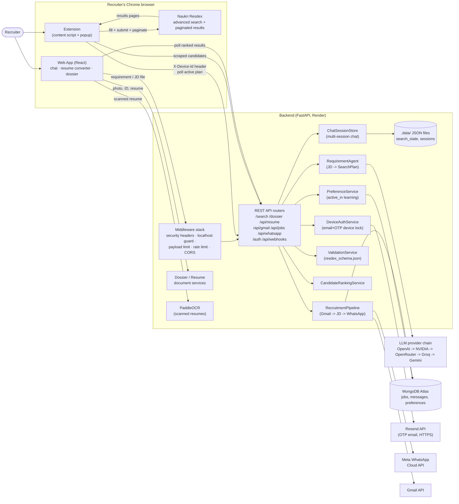
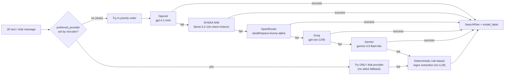
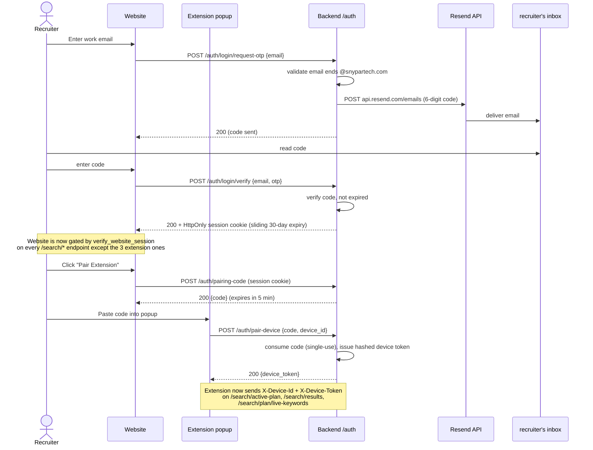
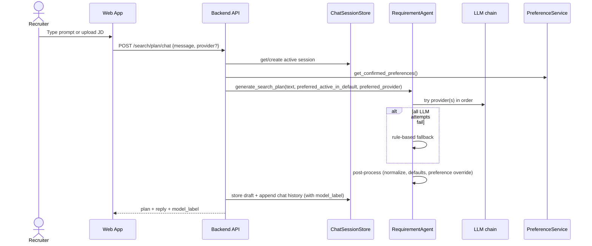
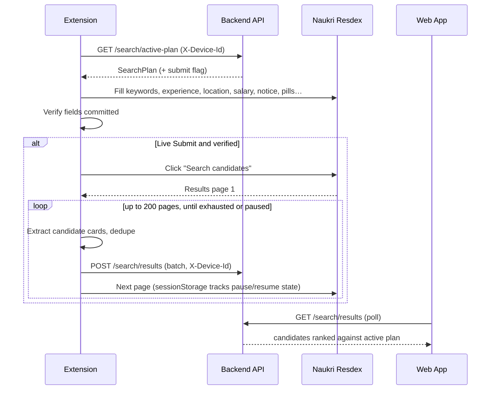
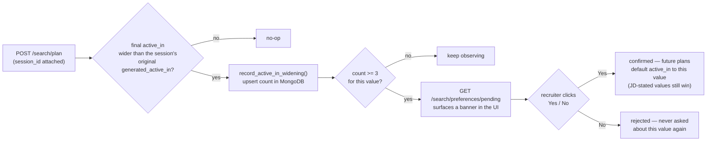

# Profile Bot AI — Technical Documentation

| | |
|---|---|
| **Document version** | 2.0 |
| **Supersedes** | TECHNICAL_DOCUMENTATION_v1.md (Sept 2026) |
| **Audience** | Engineers, maintainers, technical reviewers |
| **Status** | Live, in active use; device-lock + MongoDB Atlas + multi-provider LLM chain all in production |

## Table of Contents
1. Purpose and Scope
2. System Overview
3. Architecture
4. Components
5. Data Model — the SearchPlan
6. LLM Provider Chain
7. Key Workflows
8. Browser Extension Design
9. API Reference
10. Security and Privacy
11. Deployment and Configuration
12. Testing
13. Known Limitations and Risks
14. Change Log (v1 → v2)
15. Glossary

---

## 1. Purpose and Scope

Profile Bot AI automates four recruiter workflows:

1. **Candidate Search Automation** — a conversational chat turns a job description (typed, pasted, or uploaded as a file) into a structured search, fills Naukri Resdex's advanced-search form, submits it, reads the resulting candidates back across multiple pages, and ranks them.
2. **Candidate Dossier Compiler** — combines a candidate's photo, ID proof, and resume into one formatted `.docx` dossier.
3. **AI Resume Converter** — structures a raw resume (including scanned/image resumes via OCR) into a clean, re-generated LaTeX/DOCX document.
4. **JD → WhatsApp Broadcast Pipeline** — polls Gmail for new job descriptions, extracts and validates them, and broadcasts a formatted message to a WhatsApp group or an individual recipient list via Meta's official WhatsApp Business Platform.

Device access to the extension-facing endpoints is gated by a company-email + OTP registration flow — only known devices tied to a verified `@snypartech.com` email can read/write search state.

## 2. System Overview

| Part | Tech | Role |
|---|---|---|
| Web app | React + Vite | Recruiter UI: requirement chat (multi-session), resume converter, dossier compiler |
| Backend | Python, FastAPI | Requirement parsing, validation, session/preference state, ranking, document generation, Gmail/WhatsApp pipeline |
| Browser extension | Chrome Manifest V3, content script | Runs inside Resdex: fills form, submits search, paginates, scrapes results |
| MongoDB Atlas | Managed cloud document store | JD/WhatsApp-pipeline job tracking, learned recruiter preferences |
| External services | HTTP APIs | 5-provider LLM chain, Resend (OTP email), Meta WhatsApp Cloud API, Gmail API |

## 3. Architecture

### 3.1 System context

### 3.2 Backend layered architecture

```mermaid
flowchart TB
    subgraph Edge["Middleware (applied in this order)"]
        M1["SecurityHeadersMiddleware<br/>(CSP, X-Frame-Options)"]
        M2["LocalhostGuardMiddleware<br/>(DNS-rebinding shield)"]
        M3["PayloadLimitMiddleware<br/>(MAX_PAYLOAD_SIZE_BYTES)"]
        M4["RateLimitMiddleware<br/>(per-IP, 600 req/min,<br/>needs --proxy-headers on Render)"]
        M5["CORSMiddleware<br/>(ALLOWED_ORIGINS + regex)"]
    end
    subgraph Routers["API routers"]
        R1["/search — candidate search,<br/>chat sessions, preferences, broaden"]
        R2["/dossier"]
        R3["/api/resume — convert + OCR"]
        R4["/auth — device OTP registration"]
        R5["/api/gmail /api/jobs — JD pipeline"]
        R6["/api/whatsapp — send + groups"]
        R7["/api/webhooks — Meta delivery status"]
    end
    subgraph Services["Services"]
        S1["RequirementService -> RequirementAgent"]
        S2["ChatSessionStore"]
        S3["PreferenceService"]
        S4["DeviceAuthService + OtpService"]
        S5["ValidationService"]
        S6["CandidateRankingService / CandidateStoreService"]
        S7["DossierService / ResumeExtractor / OCRService"]
        S8["RecruitmentPipeline (JDNormalization,<br/>JDDuplicate, PolicyService, MetaWhatsAppService)"]
    end
    subgraph Data["Schemas & persistence"]
        D1["SearchPlan (Pydantic)"]
        D2["resdex_schema.json<br/>(single source of truth for enums)"]
        D3[".data/search_state.json<br/>(plan, candidates, sessions)"]
        D4["MongoDB Atlas<br/>(jobs, messages, recruiter_preferences)"]
    end
    Edge --> Routers --> Services --> Data
```

### 3.3 LLM provider fallback chain

Gemini is currently placed first for testing purposes (see `_provider_chain()` docstring) — the documented default priority is OpenAI first. Whichever model actually answers, its name is attached to the chat reply (e.g. `"gemini (gemini-3.5-flash-lite)"`) and shown in the UI.

### 3.4 Website login + extension pairing (email + OTP, then a pairing code)

The extension has no standalone auth flow of its own anymore — it inherits a
real website login via a short-lived pairing code.

## 4. Components

### 4.1 Web app (`frontend/src/`)
| File | Role |
|---|---|
| `components/SearchAgentView.jsx` | Requirement chat: session sidebar (New Chat / switch / delete), model picker, preset chips, document upload, draft keyword star-toggling, Apply/Broaden actions, preference-confirmation banner, live candidate results list |
| `components/ResumeConverterWorkspace.jsx` | Upload + OCR + LLM-structure + preview + download (LaTeX/DOCX) |
| `dossier-compiler/` | Photo/ID/resume upload workspace and result card |
| `components/Navbar.jsx`, `App.jsx` | Tab routing between the three workspaces |

### 4.2 Backend (`backend/app/`)
| Module | Responsibility |
|---|---|
| `api/search.py` | Plan generation, chat sessions, broaden/keywords, active-plan hand-off, candidate submit/list/clear, preference endpoints, provider list, requirement-document text extraction |
| `api/device_auth.py` | Website login (OTP), session cookie, pairing-code issuance, extension pairing |
| `api/resume_converter.py` | Upload, OCR, LLM-structure, LaTeX/DOCX generation, preview/download |
| `api/dossier.py` | Dossier compilation endpoints |
| `api/gmail.py`, `api/jobs.py`, `api/whatsapp.py`, `api/webhooks.py` | JD → WhatsApp pipeline: Gmail sync, job listing, WhatsApp send/groups/preview, Meta delivery-status webhook |
| `agents/requirement_agent.py` | Multi-provider LLM extraction with rule-based fallback; keyword/active_in normalization; chat-edit; `broaden_plan()` |
| `agents/jd_extraction_agent.py` | Extracts structured JD fields from raw Gmail email text |
| `services/chat_session_service.py` | Multi-session chat store (file-persisted) |
| `services/preference_service.py` | MongoDB-backed `active_in`-widening pattern detection + explicit confirm/reject |
| `services/device_auth_service.py` | Email-domain validation (`@AUTHORIZED_EMAIL_DOMAIN`) |
| `services/otp_service.py` | Resend-based OTP send/verify (shared by website login) |
| `services/web_session_service.py` | MongoDB-backed website login sessions, sliding 30-day expiry, fail-closed |
| `services/pairing_service.py` | Short-lived (5 min), single-use pairing codes bridging website login → extension |
| `services/device_token_service.py` | MongoDB-backed, sha256-hashed long-lived device tokens for the extension |
| `services/validation_service.py` | Validates a plan against `resdex_schema.json` allowed options |
| `services/candidate_ranking_service.py` | Explainable 0–100 score (skills 45 / role 20 / experience 20 / location 15) + data-completeness per candidate |
| `services/candidate_store_service.py` | Merge/dedup scraped candidates across pages |
| `services/ocr_service.py` | PaddleOCR (PP-OCRv4) for scanned/image resumes → searchable PDF + raw text |
| `services/ai_providers.py` | Same 5-provider chain used for resume structuring |
| `services/meta_whatsapp_service.py` | Official Meta WhatsApp Cloud API wrapper — text/template/broadcast send, group create/list/get/invite-link |
| `services/jd_normalization_service.py`, `jd_duplicate_service.py`, `jd_validation_service.py`, `policy_service.py` | JD pipeline: dedup, schema validation, spam/policy gate before sending |
| `services/gmail_service.py`, `jd_repository.py`, `message_tracking_service.py` | Gmail polling, MongoDB persistence for jobs/messages |
| `services/state_persistence.py` | Flat-JSON persistence for plan/candidates/sessions (`.data/search_state.json`) |
| `core/security.py` | `SecurityHeadersMiddleware`, `LocalhostGuardMiddleware`, `RateLimitMiddleware`, `PayloadLimitMiddleware`, `PIIMaskingFilter` |
| `core/device_auth.py` | `verify_device` FastAPI dependency (checks `X-Device-Id` + `X-Device-Token` against `device_token_service`) |
| `core/web_auth.py` | `verify_website_session` FastAPI dependency (checks the `web_session` cookie against `web_session_service`) |
| `db/mongodb.py` | Motor async client (5s timeout) for the JD pipeline; `services/preference_service.py` uses its own 400ms-timeout client so an unreachable Mongo never slows the hot search/chat path |

### 4.3 Extension (`extension/`)
- `content.js` (~2,960 lines) — the automation engine (see §8).
- `popup.html` / `popup.js` — manual controls: Auto-Fill, Pause, Resume, Force Re-fill, paste-a-pairing-code device pairing form.
- `manifest.json` — Manifest V3; `storage` permission; host permissions scoped to `resdex.naukri.com` and the backend's prod/local URLs.

### 4.4 Developer tooling (`tools/`)
- `resdex_recorder.js` — console-pasteable recorder that logs a human's manual form fill, used to derive selectors from real behavior.

## 5. Data Model — the SearchPlan

Same contract as v1 between backend and extension, with one new post-processing input:

| Group | Fields |
|---|---|
| Keywords | `required`, `preferred`, `excluded`, `mandatory`, `search_scope` |
| Experience | `min_experience`, `max_experience` |
| Location | `current_location[]`, `include_relocation`, `exclude_anywhere_location` |
| Salary | `salary {currency, min, max, include_unspecified}` |
| Employment | `notice_period[]`; designation/dept/industry/company fields exist in the schema but are intentionally skipped by the extension (Resdex auto-suggests from skills; filling these over-narrows results) |
| Education | `ug_qualification`, `pg_qualification` |
| Diversity / other | `gender`, `career_break`, `differently_abled`, `defence_background`, `candidate_category`, `candidate_age` |
| Job | `job_type`, `employment_type`, `work_permit[]` |
| Show-only | `verified_mobile`, `verified_email`, `attached_resume`, `candidate_display` |
| Activity | `active_in` — defaults to `"15 days"` unless the JD explicitly states one, OR a confirmed recruiter preference overrides the default (see §7.3) |
| Meta | `confidence`, `uncertain_fields[]` |
| Internal flags (not sent to Resdex) | `_submit_search`, `_keyword_sync_only`, `_broaden_search` — tell the extension which fast-path to take on the next poll |

**Business rules enforced in post-processing** (`_post_process_plan`, `_normalize_keywords`):
- Notice period values normalized to the allowed set; `"Currently serving notice period"` always added alongside any other notice period (multi-select).
- `active_in` never silently overridden by the LLM's own guess — only set if the JD explicitly states a duration, or by the hardcoded/learned default.
- `keywords.required` capped at 8, `keywords.preferred` capped at 12 (Resdex ANDs every required keyword — too many makes a search unsatisfiable).
- A JD's descriptive multi-word phrase (e.g. "Azure resource management") is decomposed into the atomic terms a real candidate profile would contain, rather than kept as one literal non-matching phrase; named proper-noun tools/credentials stay verbatim.
- Values never explicitly requested are never invented (gender, location, etc. stay `null`).

## 6. LLM Provider Chain

`RequirementAgent._provider_chain()` (search/chat) and `GroqResumeAIProvider._provider_chain()` (resume structuring) both try providers in order, falling through on failure, with every attempt logged. A recruiter can also force one specific provider via the chat UI's model picker (`GET /search/providers` lists what's actually configured) — in that mode there is **no silent fallback**: if the forced provider fails, the result is an honest rule-based/deterministic extraction, never a different model's answer presented as if it came from the requested one.

See **docs/LLM_MODEL_COMPARISON.md** for researched accuracy/cost/context-length/token-limit data on each of the 5 configured models.

## 7. Key Workflows

### 7.1 Requirement → plan (first message in a chat session)

### 7.2 Plan → Resdex → candidates (multi-page)

### 7.3 Preference learning (active_in widening)
A recruiter widening `active_in` beyond what the LLM generated, repeatedly, is treated as signal:

Nothing is ever applied silently — confirmation is always explicit, per-pattern, and reversible only by an admin editing the MongoDB document directly.

### 7.4 Broaden Search (one-click, no LLM call)
When results are too few/unsatisfying, `POST /search/plan/broaden` deterministically (a) demotes the last required keyword to preferred (never below 1 required), and (b) widens `active_in` up to a 30-day ceiling (never narrows, never exceeds it). The extension picks up the `_broaden_search` flag and re-applies both the keyword stars and `active_in` on the live Resdex tab, then re-searches.

### 7.5 Candidate ranking
Weighted, explainable score: skills (45), role (20), experience (20), location (15). A criterion the plan requires but the candidate data does not provide is reported as **unavailable** and lowers *data completeness* instead of being scored as a miss or fabricated.

## 8. Browser Extension Design

### 8.1 Fill pipeline (ordered steps, each isolated so one failure does not abort the rest)
Keywords → Experience → Location → Salary → Employment Details (Notice Period section) → Notice Period → Education → Diversity/other → Show-only pills → Active-in → verify → submit → paginate.

### 8.2 Design decisions (derived from recorded human behavior + live-trace debugging)
| Decision | Reason |
|---|---|
| Resolve dropdown options through the input's `aria-owns`/`aria-controls` list | Generic class-name scans matched stale page content |
| **Scroll the option list in steps before giving up** (`findOptWithScroll`) | Virtualized/lazy-rendered lists only paint the first few options — caused a real bug where "15 days" was unreachable and the bot silently settled for "1 day" |
| Never send Enter to confirm; use Tab / explicit option click | Enter triggers Naukri's form-level submit handler → premature partial search |
| Submit via the dedicated search button only, never a document-wide text match | A generic selector previously hit a *recent-search* link and re-ran a stale search |
| `findMandatoryStarInChip()` excludes remove/delete-labeled elements | A blind `svg, button` selector could grab a chip's delete icon instead of its mandatory-star toggle |
| `isStarMarkedMandatory()` checks multiple independent signals (`aria-pressed`, `aria-checked`, `data-active`, class patterns, title text) | A single fragile class-name guess silently broke "demote to optional" while "promote to mandatory" kept accidentally working |
| Click exact chip elements, never wrapper containers | Wrapper clicks toggled nothing |
| Keep-out list: designation, dept/role, industry, company | Naukri auto-suggests these; filling them over-narrows results |
| Pagination state in `sessionStorage`, not memory | Full-page navigation between result pages wipes JS memory |

### 8.3 Result extraction
1. Locate candidate cards (profile-link anchors, else card class fallback).
2. For each card, read fields by leaf-most class hint, then label/pattern parsing of visible text.
3. `extractAiSummary()` reads Resdex's AI-generated skills summary; if the static text looks truncated (ends in `...`), simulates a real mouse-hover event sequence and reads the fuller tooltip text that only renders on hover, falling back to the static text if no tooltip appears.
4. Send candidates plus diagnostics (containers found, per-field hit counts) to `POST /search/results`.

### 8.4 Device identity
Each install generates a random UUID (`crypto.randomUUID()`, cached in `chrome.storage.local`) sent as `X-Device-Id` on every call to the 3 device-locked endpoints, alongside a long-lived `X-Device-Token` obtained once via a pairing code (see §3.4). The popup's pairing form collects that code and exchanges it with `POST /auth/pair-device`.

## 9. API Reference

| Method & path | Router | Auth gate | Purpose |
|---|---|---|---|
| `POST /search/candidates` | search | 🔒 website | NL requirement → validated SearchPlan (legacy single-shot path; chat is now primary) |
| `POST /search/plan` | search | 🔒 website | Store a pre-built SearchPlan; records a preference observation if `session_id` given |
| `GET /search/active-plan` | search_device | ✅ device | Extension fetches latest plan |
| `POST /search/results` | search_device | ✅ device | Extension submits scraped candidates (≤ 50/batch) |
| `POST /search/plan/live-keywords` | search_device | ✅ device | Extension reports keywords live in the Resdex form, syncing the website draft |
| `GET` / `DELETE /search/results` | search | 🔒 website | List ranked / clear candidates |
| `PATCH /search/plan/keywords` | search | 🔒 website | Toggle which keywords are mandatory on the applied plan |
| `POST /search/plan/broaden` | search | 🔒 website | One-click "too few results" retry (§7.4) |
| `GET /search/providers` | search | 🔒 website | List configured LLM providers for the model picker |
| `GET /search/sessions`, `POST /search/sessions`, `POST /search/sessions/{id}/activate`, `DELETE /search/sessions/{id}` | search | 🔒 website | Multi-session chat management |
| `GET` / `POST` / `DELETE /search/plan/chat` | search | 🔒 website | Chat with a session's draft plan (`?session_id=` optional, defaults to active) |
| `GET /search/preferences/pending`, `POST /search/preferences/{key}/confirm`, `POST /search/preferences/{key}/reject` | search | 🔒 website | Preference-learning confirmation flow |
| `POST /search/upload-requirement` | search | 🔒 website | Extract text from a JD file (PDF/DOCX/DOC/TXT, ≤ 10 MB) |
| `POST /auth/login/request-otp`, `POST /auth/login/verify` | device_auth | — | Website login: send/verify OTP, sets session cookie (§3.4) |
| `GET /auth/me`, `POST /auth/logout` | device_auth | — | Session status check / clear |
| `POST /auth/pairing-code` | device_auth | 🔒 website | Issue a 5-minute single-use pairing code |
| `POST /auth/pair-device` | device_auth | — | Extension exchanges a pairing code for a device token |
| `POST /api/resume/upload`, `/ocr`, `/convert`, `GET /download/{id}/{type}`, `/preview/{id}` | resume_converter | — | Resume upload → OCR → LLM-structure → LaTeX/DOCX (not yet session-gated — see note below) |
| `POST /dossier/…` | dossier | — | Compile photo + ID + resume into `.docx` (not yet session-gated — see note below) |
| `POST /api/gmail/sync` | gmail | — | Pull new Gmail messages, run the JD pipeline |
| `GET /api/jobs/jobs`, `/jobs/{id}`, `/messages/{id}`, `POST /jd/extract`, `/jd/validate` | jobs | — | JD pipeline inspection / manual testing |
| `POST /api/whatsapp/preview`, `/check`, `/send`; `POST`/`GET /api/whatsapp/groups`, `GET /groups/{id}`, `/groups/{id}/invite-link` | whatsapp | — | Format/policy-check/send; group create/list/get/invite-link (requires OBA account status) |
| `GET`/`POST /api/webhooks/whatsapp` | webhooks | — | Meta delivery-status webhook |
| `GET /health`, `GET /` | — | — | Health/status |

Known gap: `resume_converter` and `dossier` endpoints are not yet gated by `verify_website_session` — deferred rather than bundled into this auth change, since they're reachable without a SearchPlan dependency and gating them doesn't share code with the `/search` router split. Revisit if/when those workspaces also need to be login-only.

Interactive docs: `/docs` (Swagger) when the backend runs.

## 10. Security and Privacy
- Defense-in-depth middleware stack (§3.2): security headers, localhost/DNS-rebinding guard, payload size cap, per-IP rate limiting, CORS.
- **Auth**: one switch (`AUTH_ENABLED`, off by default) gates both the website login (email OTP → HttpOnly session cookie, sliding 30-day expiry, MongoDB-backed) and the extension's device pairing (`X-Device-Id` + `X-Device-Token`, obtained only via a prior website login's pairing code — see §3.4). Both `verify_website_session` and `verify_device` fail **closed** (503) if their backing MongoDB collection is unreachable, rather than silently letting requests through — unlike this codebase's other best-effort services (`preference_service.py`, `state_persistence.py`), auth is a security boundary, not a nice-to-have.
- Login is gated to `@AUTHORIZED_EMAIL_DOMAIN` (default `snypartech.com`).
- OTP codes: 6-digit, 10-minute TTL, single-use, in-memory only.
- Pairing codes: 8-character, 5-minute TTL, single-use, MongoDB-backed.
- Device tokens: long-lived, MongoDB-backed, stored only as a sha256 hash (never in plaintext after the one-time pairing response).
- Real-time PII masking in logs (DLP filter).
- Candidate/plan/session data held in MongoDB (`state_persistence.py`) — survives Render redeploys; still single-tenant (no per-recruiter data isolation yet, even though logins are now per-recruiter).
- Extension permissions restricted to `resdex.naukri.com` and the backend's prod/local hosts.
- Rate limiting requires `uvicorn --proxy-headers --forwarded-allow-ips='*'` to correctly attribute real client IPs behind Render's internal proxy — without it, many real users collapse onto a handful of internal proxy-hop addresses and legitimate traffic gets throttled together.
- **Known gap:** `/search/candidates`, `/search/plan`, and most of the JD/WhatsApp pipeline endpoints remain unauthenticated beyond network-level protections — only the 3 extension-write-path endpoints are device-locked.

## 11. Deployment and Configuration
| Item | Detail |
|---|---|
| Backend | Docker image on Render (`render.yaml` → `backend/Dockerfile`); `uvicorn app.main:app --host 0.0.0.0 --port $PORT --proxy-headers --forwarded-allow-ips='*'` |
| System deps | `libgl1`, `libglib2.0-0` (PaddleOCR's OpenCV dependency) |
| Web app | `npm run dev` locally; static build served at `/app` by the same backend, or deployed separately (Vercel/Netlify) |
| Extension | Load unpacked from `extension/` at `chrome://extensions`; reload after every change |
| MongoDB | Atlas cloud cluster; **Network Access must allow `0.0.0.0/0`** (Render has no fixed outbound IP) |
| OTP email | Resend HTTP API (port 443) — chosen specifically because Render's free tier blocks all outbound SMTP (25/465/587); `RESEND_FROM_EMAIL`'s domain must be verified in Resend's dashboard before it can email anyone besides the account's own signup address |
| LLM keys | `OPENAI_API_KEY`, `NVIDIA_NIM_KEY`, `OPENROUTER_API_KEY`, `GROQ_API_KEY`, `GEMINI_API_KEY` — any subset; chain skips unconfigured providers |
| Without any LLM key | Falls back to deterministic rule-based parsing |
| `.env` note | Local `backend/.env` is gitignored and does **not** travel with `git push` — every secret/URI above must also be set in Render's dashboard env vars separately |

## 12. Testing
- Backend: `pytest` suite in `tests/` — 142+ tests (schema consistency, ranking, extraction, chat sessions, preference learning, device auth/OTP, OCR, WhatsApp groups, provider-chain filtering).
- Extension: `node --test tests/extension/*.test.js` — 37 tests against synthetic DOM fixtures built from real captured Resdex markup patterns (not live Resdex itself).
- One known pre-existing, unrelated failure: `test_resume_conversion.py::test_latex_generation_and_escaping` (fails on unmodified code too — not something recent changes broke).

## 13. Known Limitations and Risks
| # | Item | Impact | Status |
|---|---|---|---|
| 1 | Plan/session state in a flat JSON file, single-tenant | Different recruiters share one active plan/candidate list | Open — per-user sessions would need real multi-tenancy |
| 2 | Most endpoints beyond the 3 device-locked ones are unauthenticated | Anyone reaching the host can read/write most state | Open |
| 3 | Naukri DOM dependency | UI change can break fills silently | Mitigated — recorder tool, per-step isolation, diagnostics, multiple fallback selectors |
| 4 | Automating a third-party portal | Terms-of-service / account-risk | Open — business decision, human-in-loop by design |
| 5 | `stealth/space-bunny-alpha` (OpenRouter) is an anonymous, undisclosed model | No public accuracy benchmark exists; pricing may change without notice when the provider is revealed | Open — see LLM_MODEL_COMPARISON.md |
| 6 | MongoDB-backed features (preference learning, JD pipeline) degrade silently if Atlas is unreachable | Feature appears to "do nothing" with no user-facing error | By design (best-effort, logged) |
| 7 | Resend sandbox sender only delivers to the account owner until a domain is verified | OTP emails to other recruiters silently fail until domain verification is completed | Open — operational setup step |

## 14. Change Log (v1 → v2)
- Added: multi-session requirement chat (sidebar, New Chat, per-session history).
- Added: 5-provider LLM fallback chain (was Groq/Gemini only) + explicit per-message model picker + model-used label on every reply.
- Added: device-lock via company-email + OTP (Resend) for the extension's write path.
- Added: MongoDB Atlas (recruiter-preference learning, JD/WhatsApp pipeline persistence).
- Added: Broaden Search one-click retry; keyword-star mandatory-sync bug fixed (demote direction silently no-op'd before).
- Added: multi-page pagination (up to 200 pages) with pause/resume.
- Added: AI-summary hover-tooltip capture on candidate cards.
- Added: Resume Converter workspace (OCR via PaddleOCR, replacing Tesseract; LLM structuring; LaTeX/DOCX output).
- Added: JD → WhatsApp broadcast pipeline (Gmail polling, dedup, policy gate, Meta Cloud API send, WhatsApp Groups API).
- Fixed: rate-limit false positives on Render (missing `--proxy-headers`).
- Fixed: a frontend bug where the "Draft keywords" mandatory-star UI silently reverted on every 4-second poll tick.
- Removed: Outlook SMTP for OTP email (Render blocks outbound SMTP on the free tier) — replaced with Resend's HTTP API.

## 15. Glossary
| Term | Meaning |
|---|---|
| Resdex | Naukri's recruiter candidate-search product |
| SearchPlan | Structured JSON describing one search |
| Chip / pill | Clickable option token in the Naukri form |
| Dossier | Combined photo + ID + resume document |
| DLP | Data-leak prevention (masking of personal data in logs) |
| Chat session | One independent draft-plan + history thread; a recruiter can run several in parallel |
| Preference learning | MongoDB-backed detection of a recurring recruiter correction (currently: `active_in` widening), surfaced for explicit confirmation |
| Device lock | Company-email + OTP gate restricting which installs of the extension can talk to the backend |
| Provider chain | The ordered list of LLM providers tried for a given request, with honest fallback to rule-based extraction |
| OBA | Official Business Account status on Meta's WhatsApp Business Platform — required for the Groups API |
